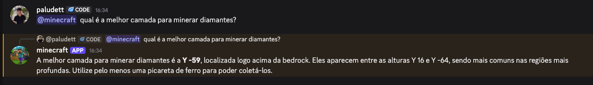
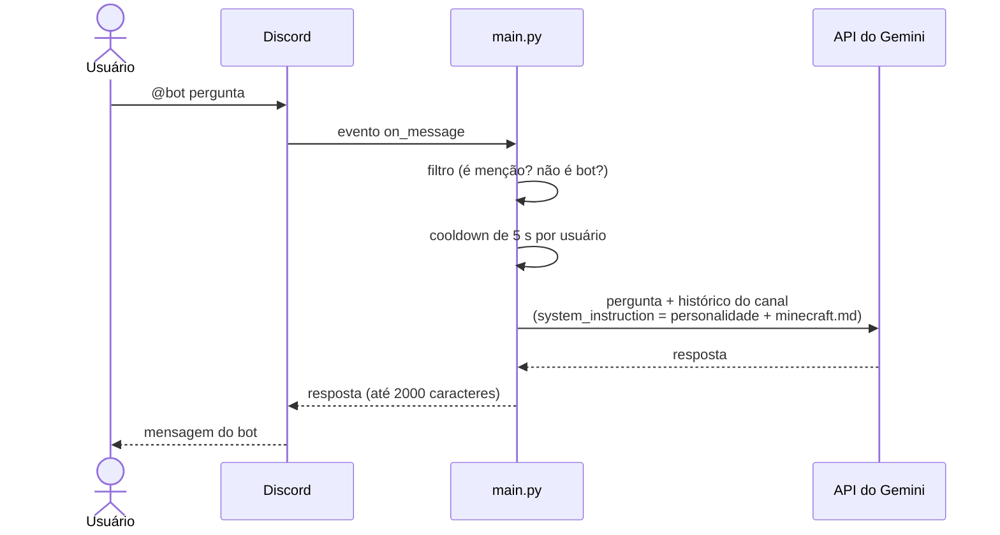
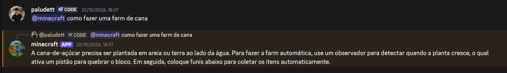
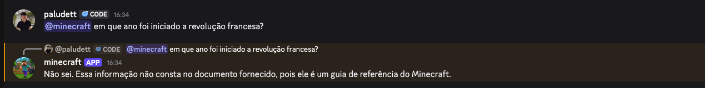

# Crie seu chatbot de IA no Discord com Python

Bot do Discord que responde quando é mencionado, lembra a conversa de cada canal, tem a personalidade que você escrever e responde com base em um documento (RAG), usando a API do Gemini.



## Sobre a oficina

Este repositório é o material base da oficina **"Chatbot de IA no Discord com Python"**, dada na **AMF** para alunos de Sistemas de Informação, na Semana Acadêmica de Sistemas de Informação. Em uma aula, cada participante sai com o próprio bot no ar, entendendo cada linha do código.

Oficina ministrada por:

- [Guilherme Stefanello](https://github.com/stfl-guilherme)
- [Lorenzo Paludett Benedetti](https://github.com/Paludett)
- [Murilo Muller](https://github.com/Muller-SR)
- [Luiz Alawi](https://github.com/luiz-alawi)

Slides da oficina: [Crie seu chatbot de IA no Discord com Python.pptx](Crie%20seu%20chatbot%20de%20IA%20no%20Discord%20com%20Python.pptx)

## O que a oficina ensina

- **Ambiente do projeto:** por que usar `venv`, como guardar segredos no `.env` e o que o `.gitignore` deixa de fora.
- **Eventos do Discord:** como o `discord.py` chama suas funções com `@bot.event` e por que usar `async`/`await`.
- **Memória por canal:** cada canal tem a sua conversa com o Gemini, então o bot lembra o que foi dito.
- **Proteções:** cooldown de 5 segundos por usuário (protege a cota gratuita) e corte em 2000 caracteres (limite do Discord).
- **Personalidade:** a `system_instruction` define como o modelo se comporta antes de qualquer pergunta.
- **RAG:** o documento [`minecraft.md`](minecraft.md) vai junto com a instrução, e o bot responde só com base nele.
- **Tool calling e MCP (conceito):** no fechamento, a ideia de a IA pedir uma função e o seu código executar, e como o MCP (Model Context Protocol) entrega ferramentas prontas ao modelo. Não está implementado neste código; veja o [Bit](https://github.com/Paludett/bot_discord_mcp) em [Exemplos do que dá para fazer](#exemplos-do-que-dá-para-fazer).

## Arquitetura

O bot é só o intermediário: recebe a mensagem do Discord, repassa para o Gemini e devolve a resposta.



O [`main.py`](main.py) está dividido em quatro partes, marcadas nos comentários:

| Parte | O que faz |
| --- | --- |
| 1. Configuração | Lê as chaves do `.env`, define o modelo, a personalidade e carrega o documento do RAG. |
| 2. Memória | Guarda uma conversa por canal e o horário da última pergunta de cada usuário. |
| 3. Filtro | Ignora outros bots e só responde quando é mencionado. |
| 4. Proteção | Aplica o cooldown e corta a resposta no limite do Discord. |

A memória fica no computador que roda o bot: ao reiniciar, ele esquece as conversas.

## RAG na prática

Com o documento no prompt, o bot responde sobre o Minecraft atual:



E, quando a pergunta não está no documento, ele diz que não sabe em vez de inventar:



## Roteiro da oficina

O histórico do git segue a ordem da aula. Para estudar passo a passo, use `git checkout <commit>` e volte com `git checkout main`:

| Commit | Passo |
| --- | --- |
| `fc4d663` | Passo 1: estrutura do projeto (`.gitignore`, `.env.example`, `requirements.txt`) |
| `8afb04b` | Passo 2: bot responde quando mencionado, com memória e proteções |
| `f27e92e` | Passo 3: personalidade com `system_instruction` |
| `b0366b6` | Passo 4: RAG com o documento do Minecraft |

Para experimentar: troque a `PERSONALIDADE` no `main.py` (há exemplos comentados de pirata e de monitor), reinicie o bot e faça a mesma pergunta. Ou troque o `minecraft.md` por um documento do seu assunto.

## Pré-requisitos

- Python 3.10 ou mais novo
- Conta no Discord e um servidor seu para testes
- Bot criado no [Discord Developer Portal](https://discord.com/developers/applications) com a **Message Content Intent** ligada
- Conta Google para gerar a chave do Gemini ([aistudio.google.com](https://aistudio.google.com))
- VS Code (ou outro editor)

## Como rodar

Abra o terminal na pasta do projeto e siga os passos do seu sistema.

| Passo | Windows (PowerShell) | Linux / macOS |
| --- | --- | --- |
| 1. Criar o venv | `py -m venv .venv` | `python3 -m venv .venv` |
| 2. Ativar o venv | `.venv\Scripts\Activate.ps1` | `source .venv/bin/activate` |
| 3. Instalar as bibliotecas | `pip install -r requirements.txt` | `pip install -r requirements.txt` |
| 4. Criar o `.env` | `Copy-Item .env.example .env` | `cp .env.example .env` |
| 5. Rodar o bot | `python main.py` | `python3 main.py` |

Depois do passo 4, abra o `.env` e cole o token do bot do Discord e a chave do Gemini. O `.env` nunca vai para o GitHub (ele está no `.gitignore`).

Quando aparecer `Online como ...` no terminal, mencione o bot em um canal do seu servidor. Para desligar o bot, aperte `Ctrl+C` no terminal.

## Quando der erro

| Erro | O que fazer |
| --- | --- |
| `Activate.ps1` bloqueado ("execução de scripts foi desabilitada") | Rode `Set-ExecutionPolicy -Scope CurrentUser RemoteSigned` no PowerShell, confirme com `S` e ative o venv de novo. |
| `ensurepip is not available` ao criar o venv (Linux) | Instale o pacote do venv: `sudo apt install python3-venv` e crie o venv de novo. |
| `PrivilegedIntentsRequired` | No [Discord Developer Portal](https://discord.com/developers/applications), abra o seu bot > **Bot** > ligue **Message Content Intent** e salve. |
| `KeyError: 'DISCORD_TOKEN'` | O `.env` não foi encontrado ou o nome está errado. Confira se o arquivo se chama `.env` (não `.env.txt`), se está na pasta do projeto e se a linha começa com `DISCORD_TOKEN=`. |
| Bot online, mas mudo | Você precisa **mencionar** o bot (`@NomeDoBot pergunta`). Confira também se a **Message Content Intent** está ligada e se o bot consegue ver o canal. |
| Bot responde "Deu erro ao falar com a IA" | Olhe o erro no terminal. Normalmente é a `GEMINI_API_KEY` errada ou o limite gratuito do Gemini estourado (espere um minuto e tente de novo). |
| `403 Forbidden` (`Missing Permissions`) | O bot não tem permissão para enviar mensagens naquele canal. Dê a permissão **Enviar mensagens** ao cargo do bot ou teste em outro canal. |

## Deploy

Para o bot ficar online 24h, ele precisa rodar em uma máquina que não desliga. O bot mantém uma conexão aberta com o Discord o tempo todo, então plataformas serverless (que só sobem o código quando chega uma requisição) não servem.

### Em uma VM ou VPS (Linux)

Qualquer servidor Linux pequeno resolve (por exemplo, o plano gratuito da Oracle Cloud). Na máquina, clone o repositório e siga os passos de [Como rodar](#como-rodar) até o passo 4. Depois crie um serviço do `systemd`, que liga o bot junto com o servidor e o reinicia se ele cair.

Crie o arquivo `/etc/systemd/system/chatbot-discord.service` (troque `usuario` e o caminho pelos seus):

```ini
[Unit]
Description=Chatbot de IA no Discord
After=network-online.target

[Service]
User=usuario
WorkingDirectory=/home/usuario/Oficina_Chat_Bot_Discord
ExecStart=/home/usuario/Oficina_Chat_Bot_Discord/.venv/bin/python main.py
Restart=always

[Install]
WantedBy=multi-user.target
```

E ative o serviço:

```bash
sudo systemctl daemon-reload
sudo systemctl enable --now chatbot-discord
journalctl -u chatbot-discord -f  # acompanha os logs
```

### Em uma plataforma (Railway, Render)

Crie o serviço como **worker** (processo contínuo, sem porta HTTP), com o comando de instalação `pip install -r requirements.txt` e o comando de início `python main.py`. Em vez do `.env`, cadastre `DISCORD_TOKEN` e `GEMINI_API_KEY` nas variáveis de ambiente do painel. O `load_dotenv()` não encontra o arquivo e o código lê direto do ambiente.

## Exemplos do que dá para fazer

Projetos usados como exemplos no final da aula:

- **[Bit — bot de Discord com Gemini e MCP](https://github.com/Paludett/bot_discord_mcp)**, por Lorenzo Paludett Benedetti. O passo seguinte a este bot: tool calling via MCP (Model Context Protocol), em que o bot descobre ferramentas de servidores MCP em tempo de execução e o Gemini decide quando usar cada uma.
- **[Bigode](https://github.com/Paludett/Bigode)**, por Lorenzo Paludett Benedetti. Bot de música do Discord feito em Go.
- **[Mestre RPG](https://github.com/Muller-SR/chat_bot_discord)**, por Murilo Muller. Bot de RPG de fantasia com criação de personagens, aventuras narradas por IA, combate entre jogadores e dados salvos em SQLite.

## Licença

Distribuído sob a licença MIT. Veja o arquivo [LICENSE](LICENSE).
